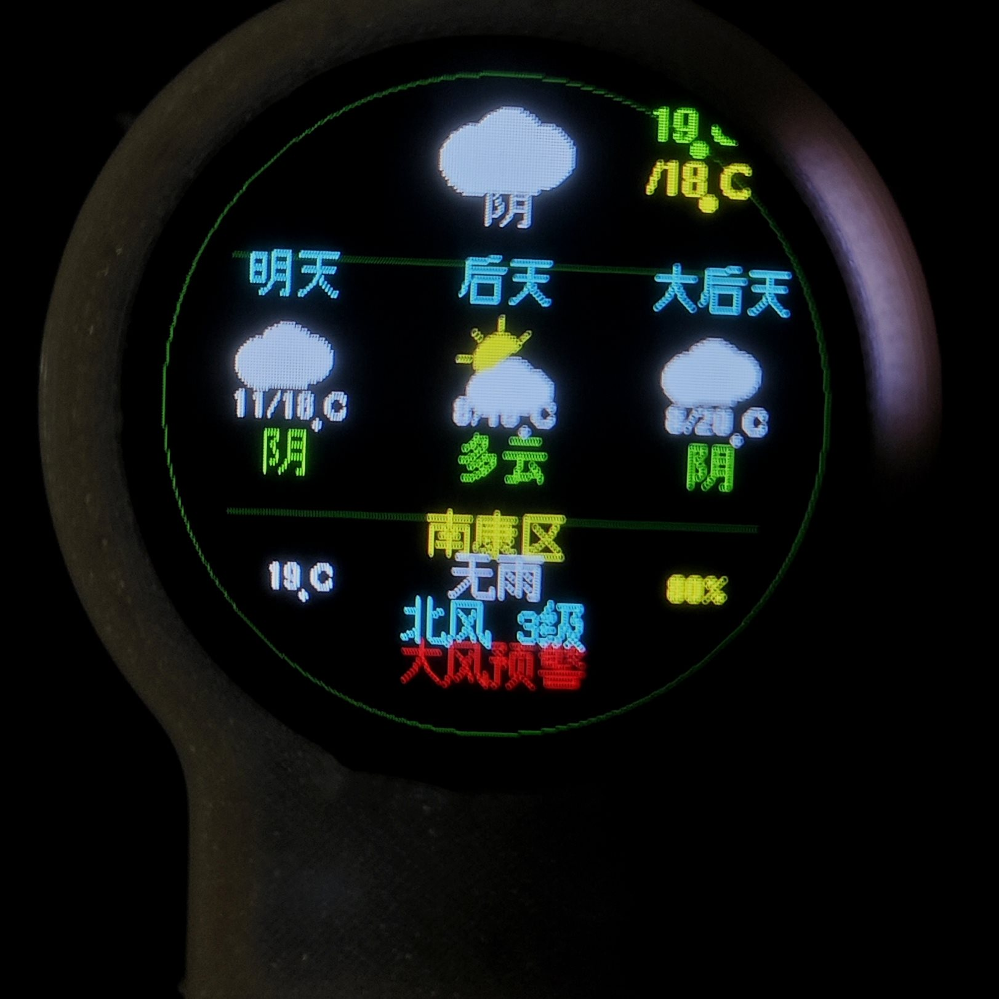
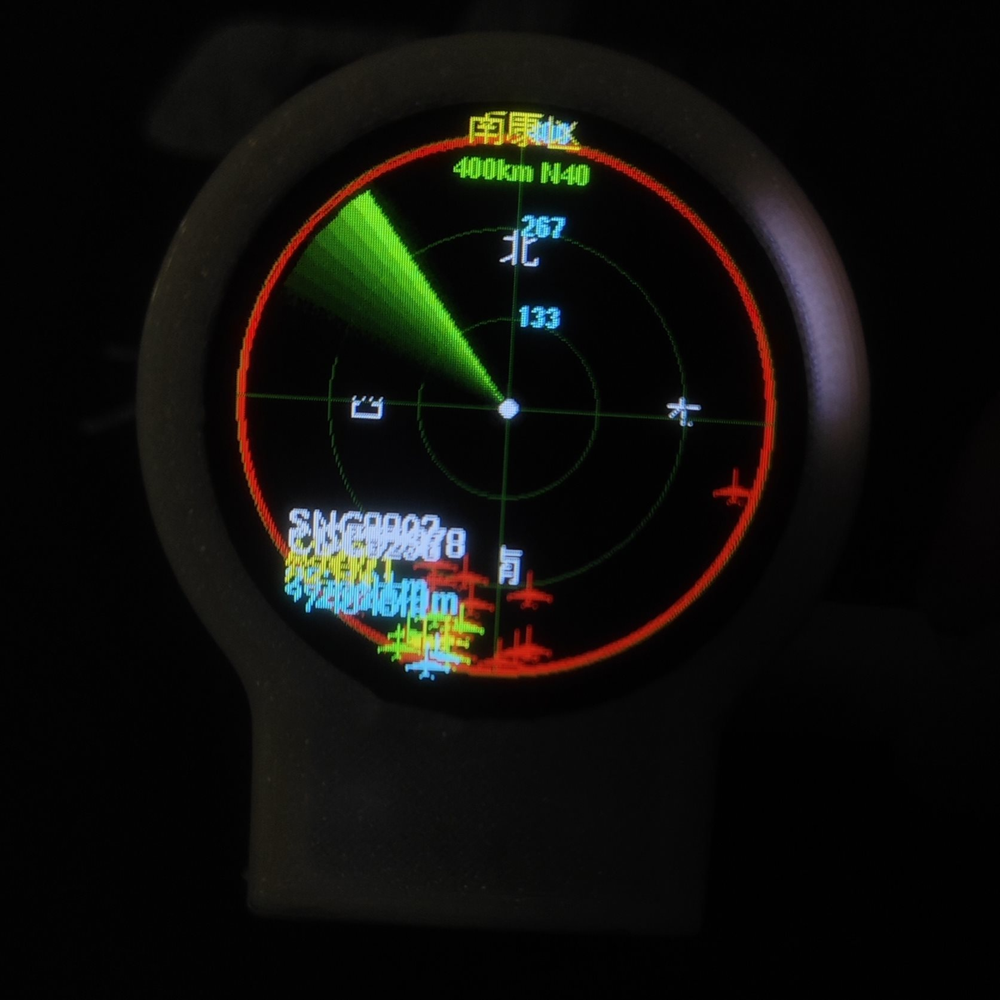
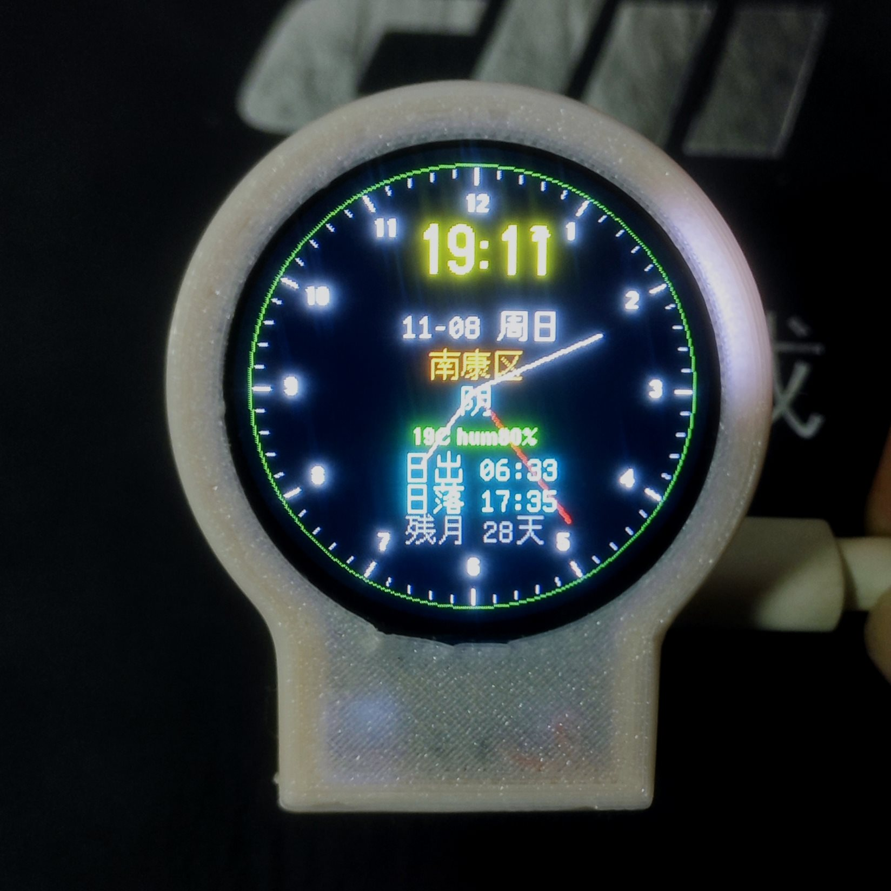
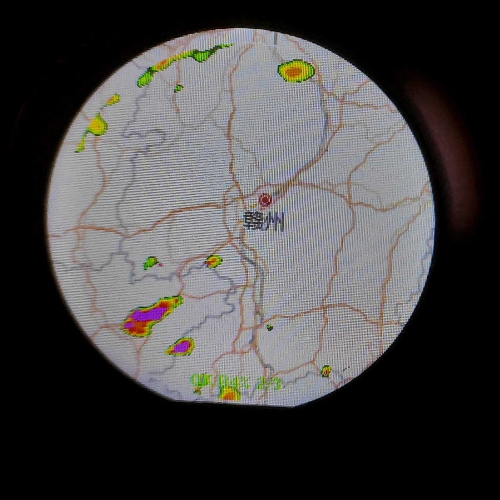
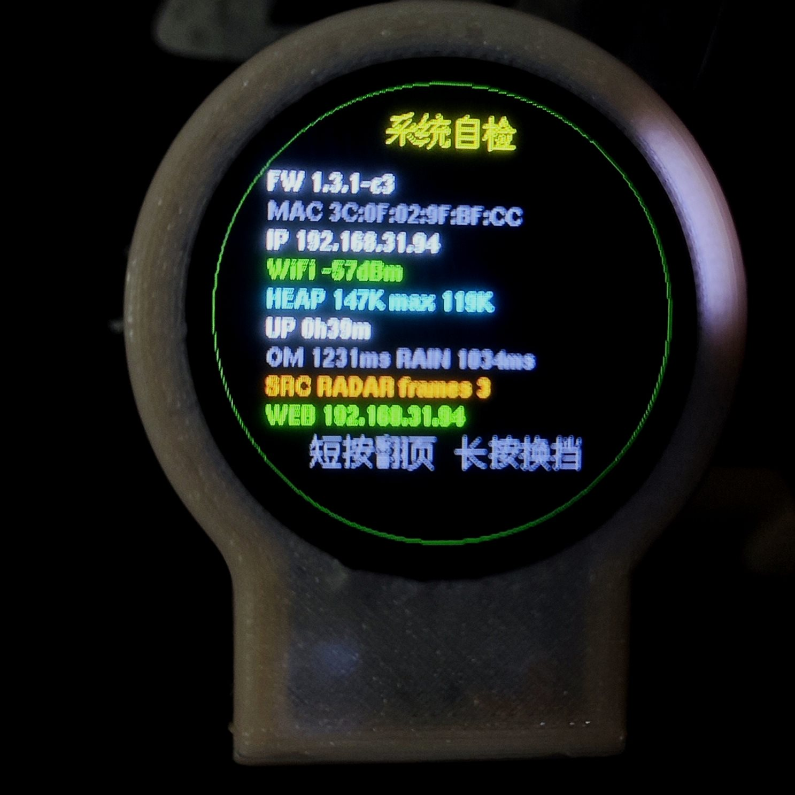

# ESP32-C3 圆屏桌面终端：航班雷达 / 天气 / 降雨云图 / 时钟 / 无人机侦测

一块 1.28 吋 240×240 圆形 IPS 屏，一颗 ESP32-C3，一个按键，不接任何其它外设。开机自动连 WiFi，六个页面轮流用：机场式扫描扇的航班雷达、带风力等级与预警的天气、带中文地图底图的降雨云图、实时走时的时钟、一页系统自检，以及一页带雷达扫描动画的无人机 RID 侦测。



| 航班雷达 | 时钟 | 降雨云图 | 系统自检 |
| :---: | :---: | :---: | :---: |
|  |  |  |  |

以上为本机实拍（照片摄于 `1.3.1-c3`；`1.4.x` 的天气页排版与新增的无人机侦测页尚未补拍），位置江西赣州南康区。

当前固件版本 **`1.4.6-c18`**：

- `c14` 天气改接中国天气网（实况 + 7 天 + 官方预警），与手机天气 App 同源；
- `c15` 新增第 6 页「无人机侦测」，整页雷达绘图（扫描扇面、三圈量程环、目标点落在量程圈上），量程按最远目标自动升档、多余每 8 秒退一档；
- `c16` 注入帧带演示距离（`km` 不再恒 0.00，可验证目标落点）；
- `c17` 网页点「开启侦测模式」立即生效：去掉 30 秒启动保护、起启判定 400ms→20ms、屏幕在 `s1` 阶段就显示「侦测已开启」；
- `c18` BLE 扫描占空回退 25%、日志节流（50% 占空在 C3 共存下会把系统拖死，已实测）。

---

## 一、它能干什么

| 页面 | 内容 | 刷新 |
| --- | --- | --- |
| 时钟 | 大字时间、日期星期、中文地名、当前天气中文、温度湿度、日出/日落、月相与月龄、模拟指针（白时分针 + 红秒针 + 60 刻度环） | 每秒重绘内盘 85px，外盘不动，无闪 |
| 航班雷达 | 红环表盘、3 道量程圈、绿色扫描扇、北东南西、按高度分色的机标（俯视飞机形，随航向旋转）、最近 3 架的呼号/机型/距离标签、可选周边机场跑道短划 | 扫描 100ms/帧；飞机数据 60s 拉一次（后台线程抓，不占帧） |
| 天气 | 当前图标与中文、当前温/今日最高、三列预报（明/后/大后）、中文地名、温度/雨况/湿度、**风向风力等级**、**官方预警条**（无预警时显示实况更新时刻 `UPD`） | 6 分钟一次，失败 30s 重试 |
| 降雨云图 | 高德中文底图整圆铺满 + 雨量彩色叠加，3 帧动画（500ms/帧），底部状态行 | 6 分钟一次，帧缓存命中则只重绘 |
| 系统自检 | 固件版本、MAC、IP、信号、堆内存与最大连续块、开机时长、两次刷新的耗时、云图源与帧数、网页地址 | 进页即显 |
| 无人机侦测 | 雷达扫描视图：8 条尾迹扇线（扫一圈约 11 秒）、三圈量程环 + 十字线、目标红点按「距离/量程」与方位落图并带 ID 末 4 字、圆心绿点；底部三行 `量程 · 架数` / **`侦测已开启`**（绿，未开启为灰）/ `BLE n  BC n` | 250ms 一帧；只擦三块不整屏刷，不闪 |

按键只有一个：**短按翻页**（时钟 → 雷达 → 天气 → 雨图 → 自检 → 无人机侦测，循环），**长按换量程**（10 → 25 → 50 → 100 → 200 → 300 → 400 km，循环）并跳到雷达页；**在无人机侦测页长按 BT 键 = 开启/停止侦测**。

> 无人机侦测**在第 6 页长按板载 BT（BOOT）键**即可开启，再长按一次停止并自动恢复联网；也可以由手机网页 `http://192.168.4.1/rid` 或局域网 `http://<板子IP>/rid` 上的「开启侦测模式」按钮控制。

---

## 二、买什么

| 东西 | 要求 | 备注 |
| --- | --- | --- |
| 主控 | ESP32-C3（4MB Flash） | 必须是 C3，`platformio.ini` 里写死了 `esp32c3` 与 4MB 分区 |
| 屏幕 | GC9A01 驱动，240×240 圆屏，SPI 四线 | 本机用的是不带触摸、无背光控制的 1.28 吋版本 |
| 线材 | 杜邦线 7 根 | VCC / GND / RST / CS / DC / MOSI / SCLK |
| 按键 | 板载 BOOT 键（GPIO9） | 不需要外接按键 |

屏幕背光（BL）本机接常亮，代码不控制；如果你的屏 BL 需要拉高才能亮，把 BL 直接接 3V3 即可。

---

## 三、接线（逐根对应，不可乱）

| 圆屏引脚 | 接 ESP32-C3 | 说明 |
| --- | --- | --- |
| VCC | 3V3 | 不要接 5V |
| GND | GND | |
| RST | GPIO0 | 代码里 `PR_RST` |
| CS | GPIO1 | 片选 `PR_CS` |
| DC | GPIO10 | 数据/命令 `PR_DC` |
| MOSI | GPIO3 | SPI 数据 `PR_MOSI` |
| SCLK | GPIO4 | SPI 时钟 `PR_SCLK` |
| BL | 3V3 | 本机常亮，代码不控 |

按键直接用板载 BOOT（GPIO9，`INPUT_PULLUP`，按下为低）。注意：**不要把按键改到 GPIO0**——GPIO0 是启动模式脚，在复位瞬间拉低会进下载模式，跟 RST 引脚打架。

SPI 速率为 40MHz（`PR_SPI_FREQ`）。如果你的屏花屏，先降到 27MHz 试。

---

## 四、从零复刻

### 1. 装环境

VS Code + PlatformIO 插件，或纯命令行：

```bash
pip install platformio
```

### 2. 源码

```bash
git clone https://github.com/15107077996/esp32c3-plane-radar.git
cd esp32c3-plane-radar
```

### 3. 改成你自己的位置

打开 `src/inc/inc01_defs.inc`，改三个宏：

```cpp
#define HOME_LAT 25.6614f    // 你的纬度
#define HOME_LON 114.7650f   // 你的经度
#define HOME_CITY "南康区"     // 你要显示的中文地名
```

经纬度可以直接从高德/百度地图上右键取。地名最多四个汉字，屏幕一行放得下四个。

> 为什么默认写死？因为很多家宽/运营商出口 IP 被解析到别的省份（本机实测被解析到北京，差了 1700 km）。所以 `s_manual` 默认 `true`，跳过 IP 定位；你要用 IP 估位，就在配网页把 `manual` 选成 `off`。

### 4. 编译

```bash
pio run
```

首次编译会自动装 `ArduinoJson`、`PNGdec`、`NimBLE-Arduino` 等依赖，约 2-4 分钟。产物在 `.pio/build/esp32c3/`。

### 5. 烧录（三种任选）

**A. 只用 USB 线，烧整包（推荐给第一次上电）**

```bash
pio run -t upload
```

**B. 已经有完整固件，只烧 app 分区**

```bash
esptool --chip esp32c3 --port COM3 --baud 460800 \
  write-flash 0x10000 firmware/app.bin
esptool --chip esp32c3 --port COM3 --baud 460800 \
  verify-flash 0x10000 firmware/app.bin
```

**C. 全新芯片/换 Flash 后，烧合并包（含 bootloader 与分区表）**

```bash
esptool --chip esp32c3 --port COM3 --baud 460800 \
  write-flash 0x0 firmware/firmware.bin
```

仓库里的 `firmware/` 由 GitHub Actions 每次推送自动重新编译并提交，里面的 `firmware.bin` 与当前源码一一对应，可当现成固件直接用。

---

## 五、配网

热点 `PlaneRadar-Setup`（无密码）**上电后一直开着**，不管板子有没有连上路由器，随时都能进去改设置。串口和自检页会同时打出两个地址：局域网 `http://<板子IP>`、热点 `http://192.168.4.1`。

1. 手机或电脑连热点 `PlaneRadar-Setup`（系统提示“该网络无法访问互联网”时选“保持连接/继续连接”）；
2. 浏览器打开 `http://192.168.4.1`（热点网关，固定不变）；
3. 首页点「配置无线WiFi连接」，填 WiFi 名/密码、城市名、经纬度，保存；
4. 板子自动重启，最多 20s 内进时钟页，热点同时继续保留。

新板、清空过 NVS 的板子、或者一直连不上保存的 WiFi 时，屏幕会停在 `SETUP WIFI` 提示页，地址还是 `192.168.4.1`。

配网信息存在 NVS（`radar` 命名空间），不会因重新烧 app 而丢。要清掉重配，把 Flash 整片擦除（`esptool erase-flash`）再烧。

**打不开页面时按顺序排查**（这几条都是真实踩过的）：

| 现象 | 原因 | 处理 |
| --- | --- | --- |
| 浏览器显示“无法连接/无法访问此网站”，地址栏却变成 `https://…` | 浏览器开了“始终使用安全连接”（Chrome/Edge 的 HTTPS-First），把 http 自动升级成 https，而板子只监听 80 | 手动把地址栏改回 `http://` 再回车；或在该浏览器设置里关掉“始终使用安全连接”；或换用系统自带浏览器/无痕窗口 |
| 连热点后打不开，但手机还显示 4G/5G 图标 | 系统把流量切回蜂窝，请求没走 WiFi | 连热点时选“保持连接”，必要时临时关掉移动数据 |
| 局域网地址打不开，热点地址能开 | 手机与板子不在同一网段（例如手机连的是 5G 频段、板子连的是 2.4G，路由器又开了频段隔离/AP 隔离） | 用热点地址 `192.168.4.1` 配网，最稳 |
| 自检页上的 IP 和路由器后台看到的不一致 | DHCP 重新分配了地址 | 以自检页 `IP` 一行为准，串口也会打 `[wifi] <IP>` |

---

## 六、网页后台

端口统一 80。两种进法：**局域网**打开自检页 `IP` 行的地址（例如 `http://192.168.31.94`）；**热点**连 `PlaneRadar-Setup` 后打开 `http://192.168.4.1`。

首页「雷达雨图设置」有五个入口：

| 入口 | 路由 | 干什么 |
| --- | --- | --- |
| 配置无线WiFi连接 | `/wifi` | 全部设置项，一张表单，保存即重启生效 |
| 无人机侦测 | `/rid` | 开始/停止被动 RID 侦测，查看收到的无人机卡片 |
| 设备信息 | `/info` | 版本、MAC、两个地址、信号、内存、运行时长、飞机/云图帧数、天气与雨图耗时、当前开关状态 |
| 退出 | `/exit` | 回一句话后重启板子 |
| 固件升级 | `/ota` | 页面里选 `app.bin` 上传，走 `POST /update`（multipart，文件域 `update`），成功 0.6s 后自动重启 |

配置页 `POST /save` 的字段（隐藏域 `v=2`，老式不带 `v` 的提交不会动三个开关）：

| 分组 | 字段 | 说明 |
| --- | --- | --- |
| WiFi 连接 | `ssid` / `pass` | WiFi 名与密码，页面上有「显示密码」按钮 |
| ✈ 航班扫描 | `lat` / `lon` | 雷达中心经纬度，保存时校验 ±90 / ±180 |
| | `unit_mi` | 勾上 = 距离全用英里（刻度、标签、页眉同时切） |
| | `apt` | 勾上 = 画周边机场跑道短划（内置 11 个机场：赣州黄金、揭阳潮汕、广州白云、长沙黄花、深圳宝安、厦门高崎、南昌昌北、香港赤鱲角、金门、泉州晋江、澳门） |
| | `anim` | 勾上 = 雷达扫描扇转动；取消则静态表盘，1 秒刷一次 |
| | `api` | 自定义航班接口地址，可用占位符 `{lat}` `{lon}` `{nm}`；留空用内置 `opendata.adsb.fi` |
| ☀ 天气预报 | 搜索框 | 输入城市中文名，点「搜索」，由板子自己联网去中国天气网检索城市 ID |
| | `city` | 屏幕上显示的中文地名 |
| | `wcode` | 中国天气网城市 ID（如南康区 `101240704`），搜索选中后自动回填 |
| 🗺 雨图与定位 | `manual` | `on` = 固定用上面的经纬度；`off` = 开机用 IP 估位 |
| | `rsrc` | `0` = 降雨雷达回波，`1` = 红外卫星云图 |

**城市搜索为什么由板子去查**：手机连的是没有外网的热点，自己搜不了，所以 `/geo?q=` 是板子用自己的 STA 连接去请求 `toy1.weather.com.cn/search?cityname=`，返回最多 6 条 `名称 / 省·市 / 城市ID`，点一条就把地名与城市 ID 一起填进表单。串口会打 `[geo] <关键词> -> N found`。

保存走 `POST /save`，写 NVS（`radar` 命名空间，`CFG_VER 108`）；写完全部 `delay(800)` + `ESP.restart()`，不用拔线。

---

## 七、数据从哪来

全部是公开接口，不需要 API Key：

| 用途 | 接口 |
| --- | --- |
| 周边飞机 | `https://opendata.adsb.fi/api/v3/lat/<lat>/lon/<lon>/dist/<nm>`，本机取 250 海里 |
| 天气实况/预报/预警 | `http://d1.weather.com.cn/weather_index/<城市ID>.html`（需带浏览器 UA 与 `Referer: http://www.weather.com.cn/weather1d/<城市ID>.shtml`，不带 UA 一律 403） |
| 城市名 → 城市ID | `http://toy1.weather.com.cn/search?cityname=<url编码>` |
| 云图元数据 | `http://api.rainviewer.com/public/weather-maps.json` |
| 雨量瓦片 | `http://tilecache.rainviewer.com{path}/256/7/{x}/{y}/2/1_1.png` |
| 红外云图瓦片 | `http://tilecache.rainviewer.com{path}/256/7/{x}/{y}/0/0_0.png` |
| 地图底图 | `http://webrd01.is.autonavi.com/appmaptile?lang=zh_cn&size=1&scale=1&style=8&x={x}&y={y}&z=7` |

天气改用中国天气网的原因：Open-Meteo 是数值模式外推，同一时刻报 11.6℃/阴，而国家站实况是 10.6℃/晴，温差与云量都对不上手机。中国天气网 `weather_index` 一次返回 `dataSK`（站点实况 + 更新时间）`fc`（7 天预报）`alarmDZ`（官方预警），与手机天气 App 同源。

刷新节奏：天气与雨图 6 分钟（`360000ms`），失败 30s 后重试（`30000ms`）；飞机 60 秒，且进雷达页前 10 秒不拉取（避免开机时 TLS 把刚起的扫描扇卡住）。

---

## 八、无人机侦测（被动 RID）

### 1. 它是什么，能收什么

被动接收符合 **ASTM F3411 / GB 46750** 的 Remote ID 广播，**不发射任何信号**、不联网、不上传：

- **WiFi Beacon**：AP 信标里的厂商自定义 IE（OUI `FA-0B-BC`），载荷是 ODID 报文；
- **BLE**：扫描广播包里的 `0xFFFA` 与 `0x16` 服务数据。

两路可以单独开也可以同时开，「侦测模式」期间设备**主动断开家里 WiFi**，只保留自己的热点 `PlaneRadar-Setup`（信道 6），因为 ESP32-C3 的 WiFi 只能固定在一个信道上嗅探，跳信道会漏包。

### 2. 开启与停止

| 操作 | 结果 |
| **长按板载 BT（BOOT）键**（在侦测页） | 不用手机网页也能开启；已开启时再长按一次即停止并恢复联网 |
| --- | --- |
| 点「开启侦测模式」 | 立即生效：HTTP 返回后 20ms 内进入启动流程，约 1.9 秒射频全部就位（BLE 控制器 + AP + 嗅探）；屏幕第 6 页底部立刻变绿字 `侦测已开启` |
| 点「只收 Beacon（不开蓝牙）」 | `/rid?on=1&ble=0`，只开 WiFi 嗅探 |
| 点「只收蓝牙（不开 Beacon）」 | `/rid?on=1&wifi=0`，只开 BLE 扫描 |
| 点「停止侦测，恢复联网」 | `/rid?off=1`，关嗅探、等 BLE 任务自己退出、重连家里 WiFi（最多 6 秒） |
| 600 秒没收到任何报文 | 自动停止并恢复联网（`RID_AUTO_STOP_MS`），不会把板子一直泡在侦测态 |
| 「注入 1 / 注入 2」 | 软件注入测试帧（不发射射频），验证解码与页面，同时让雷达页有可见目标 |

### 3. 屏幕上的雷达视图

- 半径 80px、圆心 `(120,120)`，三圈量程环（外圈 / 2/3 / 1/3）+ 十字线；
- 扫描扇 8 条尾迹线，每帧 +8°、250ms 一帧，约 **11 秒一圈**，靠外两条亮绿；
- 目标按 `距离 / 当前量程` 归一化半径、按真实方位角（0 = 北、顺时针）落红点 r=2，旁边白字是 ID 末 4 字（贴右边界时自动翻到左侧）；
- 量程五档 `200m / 500m / 1km / 2km / 5km`：开页先进最大档，目标变远立即升档，多余每 8 秒退一档（无目标时 40 秒内收到底）；
- 底部三行：`1.0km · 1架` / `侦测已开启`（绿，未开启灰字 `侦测未开启`）/ `BLE n  BC n`（青，未开启显示 `按键启动`）。

### 4. `/rid.json` 字段

```json
{"on":1,"ble":1,"wifi":1,"frames":12,"up":58,"n":2,
 "list":[{"mac":"aa:bb:cc:00:11:22","id":"TEST-RID-0001","op":"OP-TEST-001",
  "ua":"多旋翼","st":2,"la":25.665001,"lo":114.772003,"alt":100,"h":80,
  "spd":8.0,"dir":90,"ola":25.664499,"olo":114.771004,"km":0.81,
  "rssi":0,"tr":2,"age":4,"seen":51}]}
```

`on/ble/wifi` 开关状态，`frames` 解出的报文数，`up` 已运行秒数，`km` 是换算出的距离（没有位置帧时为 `-1`），`tr` 来源（1 = BLE / 2 = WiFi Beacon），`age` 最后更新距今秒数。

### 5. 为什么不持续全功率扫 BLE

BLE 扫描参数是 `setInterval 320 / setWindow 80`（占空 25%），每 6 秒窗口结束后立刻重启，看起来是连续扫描。试过 50%（`200/100`）：C3 是单核，WiFi 嗅探 + AP + BLE 同时抢射频时系统会整段失去响应（串口静默、自动停止也不执行），所以按实测退回 25%。这是共存上限，不是参数没写对。

---

## 九、几个关键实现细节

这一节是实现时踩过的坑与最终方案，改代码前建议先读。

### 1. 雨图只下拉“刚好够用”的缓冲

雨量瓦片是 256×256 RGBA，解码器内部需要一整块 `262144` 字节。ESP32-C3 在 WiFi + TLS 都活着的时候根本拿不到这么大的连续块，会直接死。所以：

- 边到边按实际瓦片 `Content-Length` 分配（实概 5-17KB），上限 `PNG_BUF_CAP 65536`；
- 解码完立即 `free`（`releasePngBuf()`），拉飞机前也先释放；
- 拉数据前先看 `ESP.getMaxAllocHeap()`，不够 `PNG_BUF_MIN 16384` 就直接在屏上打“内存不足”，不去拉网络。

### 2. 雨图“帧平移复用”

RainViewer 每 10 分钟出新帧，帧列表通常是 `{t-20, t-10, t} → {t-10, t, t+10}`，也就是三张里两张已经有了。所以进页时先试两件事：

1. 帧列表没变 + 瓦片坐标没变 → 直接重绘，不走网络（实概 1 秒）；
2. 否则把旧帧按瓦片坐标 `rename` 到新槽位（临时名中转两趟），只补拉新的那一帧。

缓存文件存在独立的 `spiffs` 分区（0x310000，896KB），文件名 `r<帧>_<瓦片>.png` / `b<x>_<y>.png`，帧列表指纹存在 `/rpath.txt`。

### 3. 飞机位置用推算，不靠刷网络

ADS-B 接口最快也就一分钟一帧，直接画会“跳一格”。所以每次只拿位置做基准，显示位置用航向 + 地速外推（`planeLive()`，上限 60 秒），屏幕就变成了连续滑行。同时保留网络基准，下一次拉取时重置。

**抓取放到后台任务里**：早期版本在帧中央同步执行 `fetchPlanes()`（TLS 握手 + 解析几十 KB JSON），每隔一分钟就会卡住一两秒，扫描扇明显顿一下。现在拆成两半：

- `fetchPlanesCore()` 只负责联网与解析，不碰任何绘制和共享全局；
- `planeFetchTask()` 跑在独立任务里（12KB 栈，优先级 1），把结果写进影子缓冲 `s_planesNew[]`，收工后置状态位（`-1` 空闲 / `-2` 失败 / `>=0` 就绪）；
- 主循环每帧查一次，就绪才 `memcpy` 进正式数组并重画表盘，所以卡顿只发生在后台任务里，屏幕照常 100ms 一帧。

开机第一次仍走同步拉取（先进雷达页那次），因为此时没有别的动画在跑，且要先 `releasePngBuf()` 腾出内存。

### 4. 扫描扇不整屏重绘，方位字最后画

每 100ms 只做：擦旧扇 → 补被扫过的环与十字线 → 画新扇 → 按新位置重画机标与标签 → **最后整组重画北东南西四个字**。整屏 `fillScreen` 会导致明显闪。

`drawRadarBase()` 里 `drawCardinals()` 永远放在最末一步，字压在扇子上面，怎么转都完整；关掉扫描动画时改成 1 秒刷一次整盘。

### 5. 字体与度符号

中文用 `u8g2_font_unifont_t_chinese4`（16px），数字用 `helvB08/helvB10`，大字时间用 `logisoso24_tn`。**Helvetica 子集没有 `°` 字形**，直接打会出现豆腐块，所以度数一律用 `fillCircle` 画一个小圆点再接 `C`。

### 6. 风力等级与预警

蒲福风级由风速（km/h）过阀值算出，0~12 级：

```
{1, 5, 11, 19, 28, 38, 49, 61, 74, 88, 102, 117}
```

风向按 8 方位转成中文（北/东北/东/东南/南/西南/西/西北），拼成“北风 3级”这一行。

预警有两套：接上中国天气网后优先照抄官方 `alarmDZ`；接口里没有官方预警时才退回本机阀值判断（命中即止，只显示一条）：

| 类型 | 条件 |
| --- | --- |
| 雷电预警 | 天气代码 ≥ 95 |
| 强降雨预警 | 明日雨量 ≥ 25mm，或天气代码 ≥ 63 且雨量 ≥ 10mm |
| 大风预警 | 明日最大阵风 ≥ 39km/h（约 6 级） |
| 大雾预警 | 天气代码 45~48 |
| 高温预警 | 当前温度 ≥ 35℃ |
| 低温预警 | 当前温度 ≤ 0℃ |
| 降雨提醒 | 明日降水概率 ≥ 80% 且天气代码 ≥ 51 |

### 7. 天气页每一行的 y 坐标

改版式直接照这个改：

| 内容 | y |
| --- | --- |
| 图标 | 32 |
| 中文描述 | 58 |
| 当前温度 | 28 |
| 今日最高 | 46 |
| 分割线 | 72 |
| 列名（明/后/大后） | 84 |
| 列图标 | 104 |
| 列最低/最高 | 126 |
| 列中文 | 144 |
| 分割线 | 158 |
| 城市名 | 170 |
| 温度 / 雨况 / 湿度 | 184 |
| 风力等级 | 200 |
| 预警（或 UPD 时刻） | 214 |

屏幕是圆的，一行文字超过 220px 就会被圆边切掉，所以字数都卡得很紧。

### 8. 侦测模式的射频顺序不能乱

C3 的 WiFi 与 BT 共用一套射频，共存状态机有硬断言。`ridStart()` 的顺序是：释放 PNG 缓冲 → `WIFI_AP_STA` + disconnect（只 init 不出流量）→ 打开 modem sleep（共存断言要求）→ 先起 BLE 任务 → 再 `softAP` 到信道 6 → 最后开 promiscuous。反过来（先开 AP 再拉 BLE）会让 BT 控制器同步长时间抢不到窗口。

`ridStop()` 不在主线程里 deinit NimBLE：只置任务退出标志，等 BLE 任务自己在下一轮循环退出（最坏等一个 6 秒扫描窗口），跨任务销毁扫描对象会撞 `_prvTaskExitError` 断言重启。

另外：侦测期间串口（USB CDC）会掉线或数据积压，看到日志断层不等于固件崩了，判活要看屏幕是否还在刷新、600 秒后是否自己回到联网态。

---

## 十、分区表与内存

`platformio.ini` 里用的是 PlatformIO 自带的 `huge_app.csv`（`board_build.partitions = huge_app.csv`），在 4MB Flash 上给出 3MB app 分区：

| 分区 | 偏移 | 大小 | 用途 |
| --- | --- | --- | --- |
| nvs | 0x9000 | 0x5000 | 配网与设置 |
| otadata | 0xe000 | 0x2000 | OTA 状态 |
| app0 | 0x10000 | 0x300000 | 固件（`1.4.6-c18` 为 1,705,008 B） |
| spiffs | 0x310000 | 0xe0000 | 雨图帧缓存 |
| coredump | 0x3f0000 | 0x10000 | 崩溃转储 |

屏幕是圆的，径向只有 112px，所有界面坐标都以 `(120,120)` 为圆心、`R_R 112` 为半径算。

---

## 十一、已知局限（如实说明）

1. **天气温度与手机仍可能差 3~4℃**。源已经和中国天气网（手机同源）一致，现象、今日高低温、三天预报都对得上；差的是站点实况的采样/上传时刻（屏上 `UPD` 会显示实况更新时间）。替代源已逐个实测走不通：中央气象台 `nmc.cn/rest/real|weather|forecast/57992` 全部返回空对象或错误页，`weather.com.cn/data/cityinfo` 301，`seven/` 是错误页，墨迹网页版是 JS 渲染取不到数。
2. **BLE 扫描占空上限 25%**。50% 实测会让系统整段无响应，不是可调参数问题，是 C3 单核 + WiFi/BLE 共存的上限。
3. **红外卫星源（`rsrc=1`）** 代码已支持，但本机多次实测 RainViewer 返回 0 帧，因此默认用雷达回波。
4. **真机还没收到过空中 RID 无人机**：本机周边确实没有合规 RID 广播的无人机，解码链路的证据来自软件注入帧（`/rid?inject=1|2`，注入目标距设备 0.81 km，`km` 与 `/rid.json` 一致）。
5. 小屏排版有边角裁切：自检页 `SRC` 行与标题左缘、雨图页底部状态行，在圆边上会差几像素。不影响读数，属版式取舍。
6. 高德底图是公开瓦片，请勿高频请求、勿商用分发；需要商用底图请换有授权的服务。
7. ADS-B 数据源为第三方公开接口，不保证长期可用；若失效，改 `fetchPlanes()` 里的 URL 即可。
8. 本固件只做**被动接收**，不发射、不伪造任何 RID 身份；伪造他人 RID 属于违法行为，代码里不提供该能力。

---

## 十二、目录结构

```
platformio.ini              平台配置（芯片、依赖、分区、构建标志）
src/main.cpp               入口，按顺序 include 下列片段
src/inc/inc01_defs.inc     引脚、颜色、结构体、全局状态、前向声明
src/inc/inc01b_ver.inc     版本号常量
src/inc/inc02_util.inc     数学与屏上文字/几何工具
src/inc/inc03_meteo.inc    天气拉取（中国天气网）、风力等级、预警判定
src/inc/inc04_icon.inc     天气图标绘制（矢量画，不用位图）
src/inc/inc05_plane.inc    飞机拉取、排序、位置外推
src/inc/inc06_radar.inc    雷达表盘、机标、标签、扫描扇
src/inc/inc07_clock.inc    时钟盘、指针、日出日落、月相
src/inc/inc08_forecast.inc 天气页排版
src/inc/inc09_rain.inc     雨图拉取、PNG 解码、帧缓存与动画
src/inc/inc10_core.inc     自检页、按键、主循环、setup
src/inc/inc11_rid.inc      RID 侦测：启动/停止、BLE 任务、WiFi 嗅探、注入帧、网页与接口
src/inc/inc11b_ridui.inc   RID 雷达视图绘制（扫描扇、量程圈、目标落点）
include/ChinaMap.h         （未接入）离线中国轮廓坐标，供未来地图页用
tools/patch_png.py         （调试期用）给 PNGdec 注入计数探针，默认不参与构建
firmware/                   CI 自动构建并提交的固件
images/                     实拍图
```

`tools/patch_png.py` 要生效需在 `platformio.ini` 里手动加一行 `extra_scripts = pre:tools/patch_png.py`；不加它不会执行，不影响正常编译。

---

## 十三、许可

MIT。源码、固件、排版参数全部可自用、可改、可再发布，保留版权声明即可。详见 [LICENSE](LICENSE)。

Firmware version `1.4.6-c18` ・ 2026
